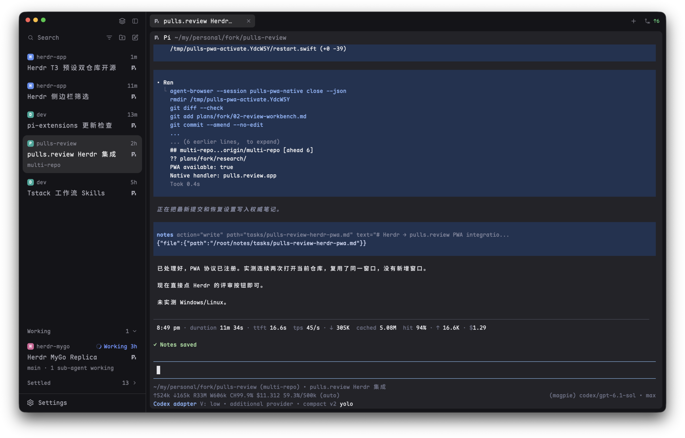

# Herdr T3

English · [中文](README.zh-CN.md)

A [T3 Code](https://github.com/pingdotgg/t3code)-like layout for Herdr App: Spaces + Agents or a Focus sidebar with T3-style Settle, slim tabs, framed panes.

Only want the Settle sidebar? It is also published alone: [herdr-t3-focus](https://github.com/JinJieBeWater/herdr-t3-focus).

## Install

Ask your Herdr agent to add `herdr.dev/layouts/JinJieBeWater/herdr-t3`. By hand: copy `layouts/t3.json`, `layouts/t3.svg` and every `mods/t3-*` into `~/.config/herdr-app/`, merge `keys.json` into yours, then switch with `ctrl-shift-l` (or `layout.switch {"name": "t3"}`). How it should look and behave: [RECIPE.md](RECIPE.md).

## What it runs

- `t3-spaces`: read-only `git status` / `git rev-parse` in your spaces' folders, watches those repos for changes (`watchFolder`), and `hc machine ls --json`.
- `t3-focus`: `hc label <agent> settled=<ms>:<turn>` when an agent is settled or unsettled.
- `t3-new-menu`: asks Herdr which agents are installed (`knownAgents`).

No network requests.

## Credits and license

`t3-chrome`, `t3-spaces`, `t3-agents`, `t3-tabs`, `t3-pane`, `t3-new-menu` and the layout start from Herdr App's shipped `workspace-chrome`, `spaces`, `agents`, `tabs`, `pane`, `new-menu` and `main`. Settle follows T3 Code's design. Apache-2.0, as Herdr App.

## More

- [herdr-t3-focus](https://github.com/JinJieBeWater/herdr-t3-focus): this layout's Focus sidebar as a standalone mod.
- [herdling](https://github.com/JinJieBeWater/herdling): a macOS menu bar companion for Herdr.
- [pi-stuff](https://github.com/JinJieBeWater/pi-stuff): my Pi extensions and skills.
