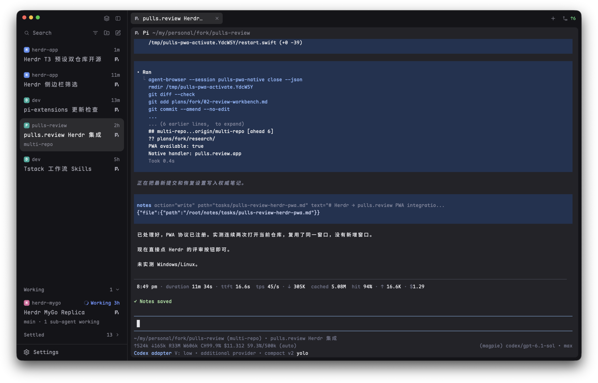

# Herdr T3

[English](README.md) · 中文

给 Herdr App 用的 [T3 Code](https://github.com/pingdotgg/t3code) 风格布局。侧栏可以在 Spaces + Agents 和带 T3 式 Settle 的 Focus 列表之间切换，另有窄标签栏和带圆角边框的窗格。



只想要 Settle 侧栏？它也单独发布了一份：[herdr-t3-focus](https://github.com/JinJieBeWater/herdr-t3-focus)。

## 安装

让你的 Herdr agent 添加 `herdr.dev/layouts/JinJieBeWater/herdr-t3`。手动安装：把 `layouts/t3.json`、`layouts/t3.svg` 和所有 `mods/t3-*` 复制进 `~/.config/herdr-app/`，把 `keys.json` 合并进你自己的，然后按 `ctrl-shift-l` 切换（或运行 `layout.switch {"name": "t3"}`）。外观和行为见 [RECIPE.zh-CN.md](RECIPE.zh-CN.md)。

## 它会运行什么

- `t3-spaces`：在各 space 的目录里运行只读的 `git status` / `git rev-parse`，监听这些仓库的变化（`watchFolder`），运行 `hc machine ls --json`。
- `t3-focus`：Settle 或取消 Settle 时运行 `hc label <agent> settled=<ms>:<turn>`。
- `t3-new-menu`：向 Herdr 查询装了哪些 agent（`knownAgents`）。

不发网络请求。

## 可选扩展

不属于布局本身，安装时也不会被复制；需要的话手动添加。

### pulls.review

`extras/mods/pulls-review/` 在 [pulls.review](https://github.com/antfu/pulls.review) 里打开当前窗格所在的仓库：有未提交改动时看这些改动，否则打开 pulls.review 的默认页面（当前分支对比默认分支）。

- **需要[我的 fork](https://github.com/JinJieBeWater/pulls.review/tree/multi-repo) 里的 CLI**（`multi-repo` 分支）。这个 mod 运行 `pulls.review -d --pwa`：`-d` 把仓库交给一个所有仓库共用的后台服务，`--pwa` 打开已安装的 pulls.review 应用，而不是浏览器标签页。上游 pulls.review 没有这两个参数。
- 只支持本机目录：窗格在其他机器上时会报错。
- 安装：把 `extras/mods/pulls-review/` 复制进 `~/.config/herdr-app/mods/`，再在 `keys.json` 的 `global` 里加一个快捷键：`"cmd-shift-r": "mod.open:pulls-review"`。
- 会运行只读的 `git status --porcelain` 和 `pulls.review`。
- 本布局的标签栏没有对应按钮，用快捷键或命令面板打开。

### 预览图里的主题和设置

`extras/themes/t3-plain.json` 是截图里的深色主题：canvas 和 chrome 为 `#141418`，accent 和 working 为 `#6b93ff`，blocked 为 `#f0a33a`。把它复制进 `~/.config/herdr-app/themes/` 后在设置里选，或者连同字体一起写进 `settings.json`：

```json
{
  "theme": "t3-plain",
  "appearance": "dark",
  "font": "Maple Mono NF CN",
  "ui_font": "Maple Mono NF CN",
  "font_size": 12,
  "minimum_contrast": 3
}
```

Herdr 不自带 [Maple Mono NF CN](https://github.com/subframe7536/maple-font)：先安装它，或者删掉字体这几行，沿用 Herdr 的 JetBrains Mono 和 Geist。

### 我配套用的快捷键

写在 `keys.json` 的 `global` 里，另外还有布局自带的 `cmd-shift-b`：

| 快捷键 | 命令 | 作用 |
| --- | --- | --- |
| `cmd-]` / `cmd-[` | `agent.next` / `agent.prev` | 按 Focus 卡片的顺序切换 agent，已 Settle 的排在最后 |
| `cmd-p` | `mod.open:picker` | 和 Focus 顶栏的 Search 是同一个选择器 |
| `cmd-shift-r` | `mod.open:pulls-review` | 审阅当前仓库（需要上面的扩展） |

## 致谢与许可证

`t3-chrome`、`t3-spaces`、`t3-agents`、`t3-tabs`、`t3-pane`、`t3-new-menu` 和布局本身，分别基于 Herdr App 自带的 `workspace-chrome`、`spaces`、`agents`、`tabs`、`pane`、`new-menu` 和 `main` 修改。Settle 参照 T3 Code 的设计。许可证与 Herdr App 相同，为 Apache-2.0。

## 更多

- [herdr-t3-focus](https://github.com/JinJieBeWater/herdr-t3-focus)：本布局的 Focus 侧栏，单独作为 mod 发布。
- [herdling](https://github.com/JinJieBeWater/herdling)：Herdr 的 macOS 菜单栏伴侣。
- [pi-stuff](https://github.com/JinJieBeWater/pi-stuff)：我写的 Pi 扩展和 Skills。
