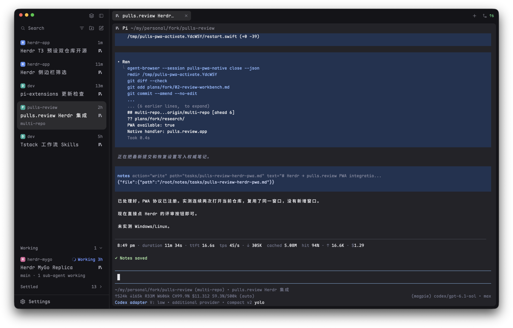

# Herdr T3

A calm, T3 Code-like window for Herdr App: a 268px sidebar on the left that switches between Spaces + Agents and a Focus list with T3-style Settle, a slim tab bar, rounded panes with a small header, and an agent view that shows one agent full size instead of the tab. Everything sits on the theme's own colors; nothing is loud unless an agent needs you.

## What you see

Left to right, divider 1px `border`:

- **Sidebar** (268px, min 180, max 480, not resizable by drag, `chrome` background), top to bottom:
  - **Brand bar** (40px, drags the window, room for the macOS window buttons): at the right, two 26px buttons: sidebar mode (`circle-check` icon: show Focus; `layers`: show Spaces and Agents) and hide sidebar.
  - **Lists**, one of two (a stack):
    - **Spaces + Agents**, split 1:1 (each at least 90px). Spaces: colored square avatars with the space initial, worktrees folded under their checkout with tree lines, grouped by machine once there is more than one; after the name, only unusual git info (`repo · branch ↑2 ↓1`; `main` / `master` left out). Agents: grouped by space or by priority (a sort menu), pinned agents in a `Pinned` group, sub-agents indented under their parent with tree lines; a 14px state mark flush right.
    - **Focus**: the T3 sidebar. Cards for the agents that need you, a folded Working shelf and a folded Settled shelf at the bottom (see `mods/t3-focus`; the [standalone recipe](https://github.com/JinJieBeWater/herdr-t3-focus/blob/main/RECIPE.md) describes it fully).
  - **Footer** (41px, top border): a Settings row, with a 6px `accent` dot when an app update is ready, and an independent `T3` button opening a centered 600×460 settings dialog. It keeps Focus border under Appearance and Auto release under Behavior.
- **Work column**:
  - **Tabs** (40px, drags the window): the active space's tabs as 28px pills (radius 6, `selected` when active), program icon, name (a tab nobody named reads as its agent, else its focused pane, by the naming rule below), a spinner when working, `!` badge when blocked, a 7px `done` dot when done and unseen; close `×` on the active one. Then a 26px view toggle (`square` icon: show one agent; `layers`: show tabs) and `+` (opens `t3-new-menu`). In the agent view the pills give way to an agent bar: program icon, the agent's name (`foreground`), its space (`dim`), its state mark. Window buttons on Windows. With the sidebar hidden, a sidebar toggle at the left also counts agents: blocked, working, done.
  - **Work body** (padding 2/8, gap 8), one of two (a stack):
    - **Panes**, the active tab: radius 8, `background` fill, a 2px `accent` ring on the focused pane (its border is the same 2px in `background`, so focusing doesn't resize the terminal), even a lone pane framed. Each has a 28px header on top: program icon, agent name or terminal title (13px medium, `foreground` when focused), folder, state mark, and buttons split right, split down, zoom/unzoom, close (shown on hover).
    - **Agent view**: one agent's terminal full size, `background` fill, radius 8, no header.
  - 6px bottom inset; the shipped `workspace-status` bar is in the layout but hidden.
- **New menu** (`t3-new-menu`, popup 520×420 at the top): first pick a space (or New space), then what to start there: a terminal or each installed agent; `⌘1…` pick spaces by number.

## How it behaves

- **Names**, one rule everywhere (focus cards, agents list, tabs, pane headers), in `mods/t3-focus/name.js` with a copy in each mod that uses it: the Pi session (`pi.session` label), then for agents a tab someone named, then a telling terminal title (not a path, not `user@host`, not the program's own name), else the program's name.
- **Agent statuses**, the same marks everywhere (agents list, tabs, pane headers, focus cards): working: spinner in `working`; blocked: a 14px rounded `!` badge on `blocked` at 15% opacity; done: a 7px `done` dot (Focus: green `Done`); idle: a ring in the agents list, nothing elsewhere. A parent shows its most urgent sub-agent's state; a sub-agent's `error` counts as blocked.
- **Sidebar mode**: the brand bar button or `cmd-shift-b` (`t3-chrome.sidebar`) runs `layout.select` on stack `sidebar-lists` (`lists` / `focus`). With Focus showing, a settled agent's done dot is left out of the tabs and the sidebar toggle's counts.
- **Spaces**: click switches, right-click opens the shipped `menu`, drag reorders; hovering a checkout's avatar turns it into the fold arrow for its worktrees. Git is read only when it could have changed (a new place, a finished command or turn, a machine back) and at a slow fallback while the window is in front.
- **Agents**: click runs `agent.focus` (with the tabs it focuses that pane; in the agent view it picks the agent shown), as Focus cards do; hover shows a pin button in the state slot (nothing moves); hovering a parent's icon folds its sub-agents, and a folded row shows a dim count. A done agent you are viewing stays in Done until you leave it.
- **Focus / Settle**: hover a finished card for `✓ Settle`; hover a settled row for the undo arrow; new work (working, blocked, or a finished turn since) brings it back by itself. No auto-settle.
- **Released Pi**: disabled by default. Only the explicit shared setting `t3.auto-release=true`, controlled by **T3 → Behavior → Auto release**, enables new releases. Once a top-level Pi has been settled for 30 minutes, the brand bar may release its whole tree if every member is idle/done, resumable, unpinned and out of view. Save each session path before stopping anything; put `t3-released` beside every terminal pane, re-read the tree and its turns, then stop the parent before its surviving children. Turning the setting off during preparation cancels release at the final check. Cards, rows and tabs keep their names and a dim `Released` label. Opening the saved tab reconnects only the parent. Child panes offer manual Resume. Turning off auto release keeps existing saved conversations reconnectable. Plain idle time never triggers release.
- **Tabs**: click selects, double-click renames, drag reorders, right-click menu, scroll wheel goes to the previous/next tab (agent, in the agent view).
- **Supported agents**: Settle works for all agents; automatic release is Pi-only and off by default. Claude Code, Codex and other programs are never auto-released, and their presence in a Pi tree prevents the whole tree from being released. The settings label is `Auto release (Pi only)`.
- **Agent view**: the toggle or `cmd-shift-a` (`t3-tabs.view`) runs `layout.select` on stack `view` (`main` / `agent`). It keeps the keyboard on its agent, so what would land unseen brings the tabs back: a new shell or mod pane in the focused space (a split, a new tab; then `pane.focus` on it), anything started from `+` (`t3-new-menu` leaves the view first), focus moved by keys to a shell. A new agent pane doesn't take the view; focus moved by keys to an agent pane shows that agent.
- Pins, folds, sort, filter and shelf state are kept per screen (`localStorage` / shared state `agents.sort`, `space.colors`).

## Built from

- `layouts/herdr-t3.json`: `row` root → `sidebar` column [`brand` block `t3-chrome`; `sidebar-lists` stack [`lists` column [`spaces` `t3-spaces`, `agents` `t3-agents`], `focus` `t3-focus` with props `{ "newMenu": "t3-new-menu" }`]; `sidebar-footer` `t3-chrome` with props `{ "footer": true }`] and `work` column [`tabs` `t3-tabs`; `work-body` row [`view` stack, active `main` [`main` `{ "tab": "active", "pane": { "header": { "content": { "mod": "t3-pane" } } } }`, `agent` `{ "agent": "focused" }`]]; `work-bottom-inset`; `status` `workspace-status`, hidden]. Preview: `layouts/herdr-t3.svg`.
- Mods: `t3-chrome`, `t3-spaces`, `t3-agents`, `t3-focus`, `t3-tabs`, `t3-pane` and `t3-new-menu` are reworked from Herdr's shipped `workspace-chrome`, `spaces`, `agents`, `tabs`, `pane` and `new-menu`; `t3-focus` is new. Shipped mods used as they are: `workspace-status`, `picker`, `menu`, and icons from `mods/workspace-chrome/` and `mods/pane/close.svg`.
- `keys.json`: `layout:herdr-t3` → `cmd-shift-b`: `t3-chrome.sidebar`, `cmd-shift-a`: `t3-tabs.view`.
- `t3-settings`: native Switch controls; Focus border updates only the latest layout's focus color on click, Auto release persists a boolean in shared state. Rendering changes neither the layout nor the setting.
- Programs: `t3-spaces` runs read-only `git status` / `git rev-parse` (no optional locks, no fsmonitor) and `hc machine ls --json`; `t3-focus` runs `hc label <agent> settled=<ms>:<turn>`.
- `t3-chrome/release.js` checks once a minute in this layout; `hc ls/get/label/kill/rm` saves and ends Pi trees and cleans records after their tabs close. `t3-released` reads the last output and uses `pane.split {argv:["pi","--session",file]}` at its saved position. Wait for the new Pi's exact `pi.session_file` before removing the old core record and placeholder. Preserve the Settle time, but use the new terminal's turn counter. Failures leave the session recoverable and offer Retry.
- `mods/t3-focus/released.js` is copied to the lists, chrome and placeholder by `scripts/sync.sh`. Saved records live in shared `t3.released`, placeholder props and core labels `t3.resume`, `t3.released`, `t3.record`; the shared record has the actual placeholder pane id. Pins use the machine and Pi session path so reconnecting doesn't lose them. The standalone sidebar never runs the release loop.
- Reconnection claims a Core-unique live name `t3-resume-<old-id>` using `hc run --rm --no-parent --no-notify --bg --name … -- node -e 'setTimeout(()=>{},60000)'`. Losing clients wait and reuse the replacement label; the winner removes the claim in `finally`. Rebase saved ids using the current screen's space UUID and machine before querying Core; props themselves are not machine-qualified. Startup polling runs on the one-second timer, never from render.

## Watch out

- `t3-tabs` and `t3-chrome` find the stack with `find(layout(), "sidebar-lists")`; keep the node ids `sidebar`, `sidebar-lists`, `lists`, `focus`. Likewise `t3-tabs` and `t3-new-menu` look for `view` with children `main` and `agent`; without it there's no toggle.
- Only the brand bar's `t3-chrome` copy listens for `nextCommand()`; the footer copy has nothing to switch.
- In the agent view Herdr does create and focus a new split or tab, but the view stays and the agent block falls back to some other agent: input goes to a pane nobody sees. `t3-tabs` notices new panes and focus moves in `render` (it is always in the layout) rather than catching each command, so keys, the palette and `hc` are covered alike.
- A mod's `render` doesn't run while the window isn't repainting (in the background): test the agent view's exits with the window in front.
- Git that touches the index wakes the folder watch again: always pass `--no-optional-locks -c core.fsmonitor=false`.
- A settled label takes about 0.65s to show in `terminals()`: keep a pending value.
- A pane mod's custom props do not supply its own pane id; save the id returned by `pane.split`. Core cannot atomically check idle and stop the tree: recheck immediately before kill. New work in that remaining gap is still possible. Other layouts can reconnect placeholders but do not start new releases. Shipped agent lists and external tools omit released processes; manual recovery uses `hc get <old-address> --json` → `t3.resume` → `pi --session <file>`.
- On macOS with no title bar, the tabs leave room for the window buttons when the sidebar is hidden or narrow (`layout().traffic_lights`).
- `mods/t3-spaces/check-sidebar.cjs` and `mods/t3-pane/check-pane.cjs` load the mods in a fake `herdr`; run them with `node` from an installed home, since they look for the shipped icons there.

## Done when

- `herdr-app check` passes for every `mods/t3-*` and `layout.switch {"name": "herdr-t3"}` shows the window above.
- `node mods/t3-spaces/check-sidebar.cjs` and `node mods/t3-pane/check-pane.cjs` print their `ok` lines.
- `cmd-shift-b` switches the sidebar between Spaces + Agents and Focus.
- `cmd-shift-a` shows one agent; clicking a sidebar card shows that one; splitting a shell there brings the tabs back, focused on the shell.
- Settling a finished agent in Focus moves it to Settled and removes its done dot from the tab; prompting it again brings it back.
- `node mods/t3-chrome/check-release.cjs` passes. A temporary Pi settled for 30 minutes releases without losing its tab; opening it starts one replacement with the same conversation, while the children stay released. A working child, changed turn, new child, pin, opened tab or layout switch before kill cancels release. Failed startup keeps the old record and permits Retry.
- A worktree space appears folded under its checkout; a remote machine gets its own header.
