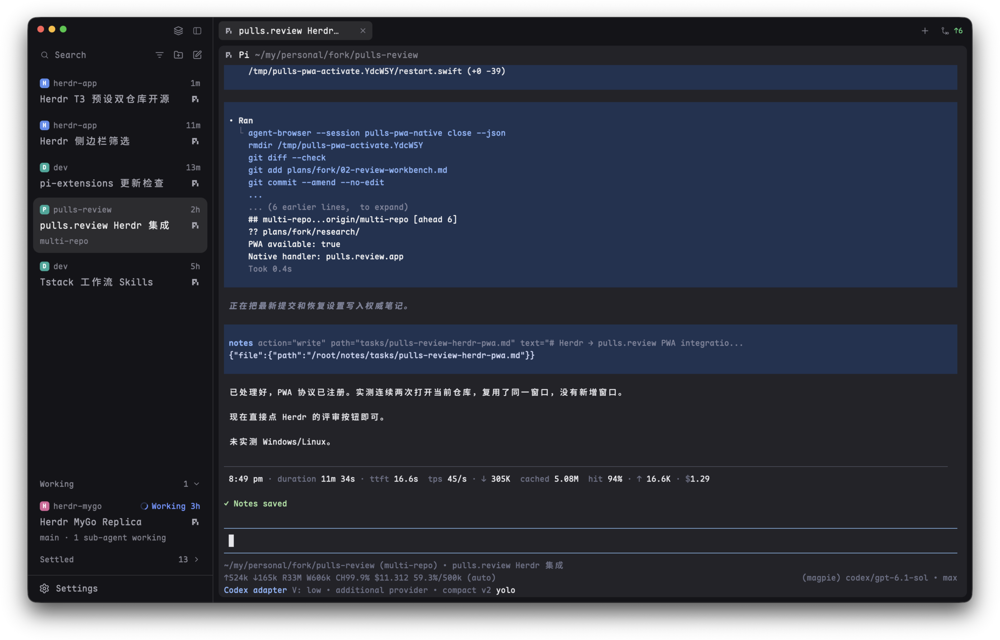

# Herdr T3

> 中文译本。给 agent 构建用的正本是 [RECIPE.md](RECIPE.md)，两者不一致时以英文为准。

Herdr App 的一个安静、近似 T3 Code 的窗口：左侧 268px 侧栏，可在 Spaces + Agents 和带 T3 式 Settle 的 Focus 列表之间切换；窄标签栏；圆角窗格带小标题栏。全部使用主题自身的颜色，只有 agent 需要你时才醒目。

## 你看到什么

从左到右，分隔线 1px `border`：

- **侧栏**（268px，最小 180，最大 480，不能拖动调整，`chrome` 背景），从上到下：
  - **品牌栏**（40px，可拖动窗口，给 macOS 窗口按钮留位置）：右侧两个 26px 按钮：侧栏模式（`circle-check` 图标：显示 Focus；`layers`：显示 Spaces 和 Agents）、隐藏侧栏。
  - **列表**，二选一（stack）：
    - **Spaces + Agents**，1:1 分割（各至少 90px）。Spaces：彩色方形头像带 space 首字母；worktree 折叠在其主 checkout 下，带树线；机器多于一台时按机器分组；名字后面只显示不寻常的 git 信息（`repo · branch ↑2 ↓1`，省略 `main` / `master`）。Agents：按 space 分组或按优先级（排序菜单），置顶的在 `Pinned` 组，子 agent 带树线缩进在父级下；14px 状态标记靠右。
    - **Focus**：T3 侧栏。需要你的 agent 显示为卡片，底部是折叠的 Working 和 Settled 收纳区（见 `mods/t3-focus`；[单独 mod 的 recipe](https://github.com/JinJieBeWater/herdr-t3-focus/blob/main/RECIPE.zh-CN.md) 有完整说明）。
  - **底栏**（41px，上边框）：一行 Settings；App 更新就绪时带一个 6px `accent` 圆点。
- **工作区**：
  - **标签栏**（40px，可拖动窗口）：当前 space 的标签，28px 胶囊（圆角 6，当前标签 `selected`）：程序图标、名字（自动名 `tb3` 显示为程序名），工作中显示转圈，blocked 显示 `!` 徽章，done 且未看显示 7px `done` 圆点；当前标签有关闭 `×`。然后是 `+`（打开 `t3-new-menu`）。Windows 上有窗口按钮。侧栏隐藏时，最左边出现侧栏开关，同时统计 agent：blocked、working、done。
  - **窗格**（内边距 2/8，间距 8）：圆角 8，无边框和焦点环，`background` 填充，单个窗格也带框。每个窗格顶部有 28px 标题栏：程序图标、agent 名或终端标题（13px 中粗，聚焦时 `foreground`）、目录、状态标记，以及右分屏、下分屏、缩放/取消缩放、关闭按钮。
  - 底部留 6px；布局里有自带的 `workspace-status` 状态栏，但隐藏。
- **新建菜单**（`t3-new-menu`，520×420 弹层，位于顶部）：先选 space（或 New space），再选在那里启动什么：终端或任一已安装的 agent；`⌘1…` 按编号选 space。

## 它怎么表现

- **agent 状态**，各处（agents 列表、标签、窗格标题、focus 卡片）标记一致：working：`working` 色转圈；blocked：14px 圆角 `!` 徽章，底色为 15% 不透明的 `blocked`；done：7px `done` 圆点（Focus 里是绿色 `Done`）；idle：agents 列表里是圆环，其余位置不显示。父级显示子 agent 中最紧急的状态；子 agent 的 `error` 视为 blocked。
- **侧栏模式**：品牌栏按钮或 `cmd-shift-b`（`t3-chrome.sidebar`）对 stack `sidebar-lists` 执行 `layout.select`（`lists` / `focus`）。显示 Focus 时，标签栏和侧栏开关的计数里不再显示已 Settle agent 的完成圆点。
- **Spaces**：单击切换，右键打开自带 `menu`，拖动排序；悬停 checkout 的头像时它变成 worktree 的折叠箭头。只在 git 可能变化时读取（新位置、命令或轮次结束、机器重新连上），窗口在前台时另有慢速兜底轮询。
- **Agents**：单击聚焦；悬停时状态位变成置顶按钮（布局不动）；悬停父级图标可折叠子 agent，折叠后显示淡色数量。你正在看的 done agent 留在 Done 组，直到你离开。
- **Focus / Settle**：悬停已结束的卡片出现 `✓ Settle`；悬停已 Settle 的行出现撤销箭头；有新工作（working、blocked，或 Settle 后又结束过一轮）自动回来。不做自动 Settle。
- **标签**：单击选中，双击改名，拖动排序，右键菜单，滚轮切换上/下一个标签。
- 置顶、折叠、排序、筛选和收纳区状态按屏幕保存（`localStorage` / 共享状态 `agents.sort`、`space.colors`）。

## 由什么构成

- `layouts/t3.json`：根为 `row` → `sidebar` 列 [`brand` 块 `t3-chrome`；`sidebar-lists` stack [`lists` 列 [`spaces` `t3-spaces`、`agents` `t3-agents`]、`focus` `t3-focus`]；`sidebar-footer` `t3-chrome`，props `{ "footer": true }`]，以及 `work` 列 [`tabs` `t3-tabs`；`work-body` 行 [`main` `{ "tab": "active", "pane": { "header": { "content": { "mod": "t3-pane" } } } }`]；`work-bottom-inset`；`status` `workspace-status`，隐藏]。预览图：`layouts/t3.svg`。
- Mods：`t3-chrome`、`t3-spaces`、`t3-agents`、`t3-tabs`、`t3-pane`、`t3-new-menu` 分别改自 Herdr 自带的 `workspace-chrome`、`spaces`、`agents`、`tabs`、`pane`、`new-menu`；`t3-focus` 是新写的。原样使用的自带 mod：`workspace-status`、`picker`、`menu`，以及 `mods/workspace-chrome/` 下的图标和 `mods/pane/close.svg`。
- `keys.json`：`layout:t3` → `cmd-shift-b`：`t3-chrome.sidebar`。
- 运行的程序：`t3-spaces` 运行只读的 `git status` / `git rev-parse`（不加可选锁、不用 fsmonitor）和 `hc machine ls --json`；`t3-focus` 运行 `hc label <agent> settled=<ms>:<turn>`。

## 注意

- `t3-tabs` 和 `t3-chrome` 用 `find(layout(), "sidebar-lists")` 找 stack；保留节点 id `sidebar`、`sidebar-lists`、`lists`、`focus`。
- 只有品牌栏那份 `t3-chrome` 监听 `nextCommand()`；底栏那份没东西可切换。
- 碰到 index 的 git 命令会再次唤醒目录监听：始终带上 `--no-optional-locks -c core.fsmonitor=false`。
- Settle 标签大约 0.65 秒后才出现在 `terminals()`：要保留待定值。
- macOS 无标题栏时，侧栏隐藏或很窄，标签栏要给窗口按钮留位置（`layout().traffic_lights`）。
- `mods/t3-spaces/check-sidebar.cjs` 和 `mods/t3-pane/check-pane.cjs` 用假的 `herdr` 加载 mod；要在已安装的 home 里用 `node` 运行，因为它们在那里找自带图标。

## 完成标准

- 每个 `mods/t3-*` 都通过 `herdr-app check`，`layout.switch {"name": "t3"}` 显示上面描述的窗口。
- `node mods/t3-spaces/check-sidebar.cjs` 和 `node mods/t3-pane/check-pane.cjs` 输出各自的通过行。
- `cmd-shift-b` 在 Spaces + Agents 和 Focus 之间切换侧栏。
- 在 Focus 里 Settle 一个已结束的 agent，它移入 Settled，标签上的完成圆点消失；再给它发提示，它回来。
- worktree space 折叠显示在它的 checkout 下；远程机器有自己的分组标题。
